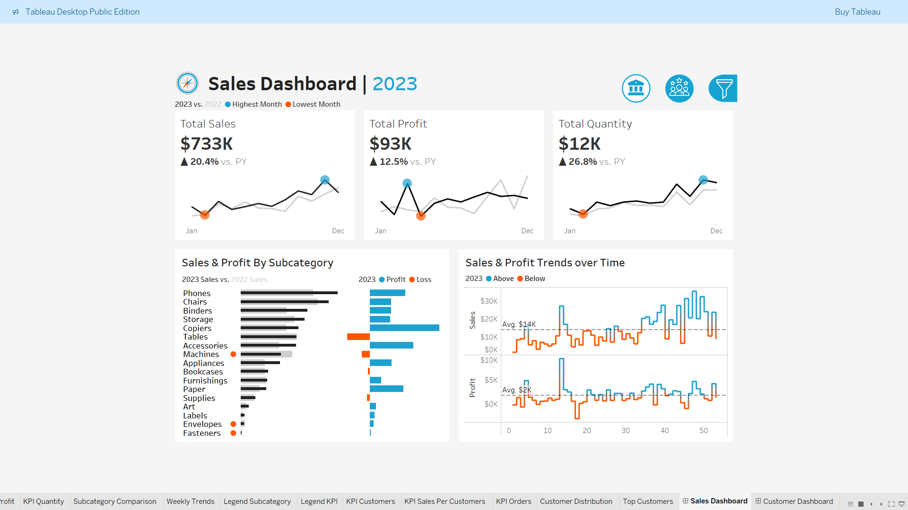
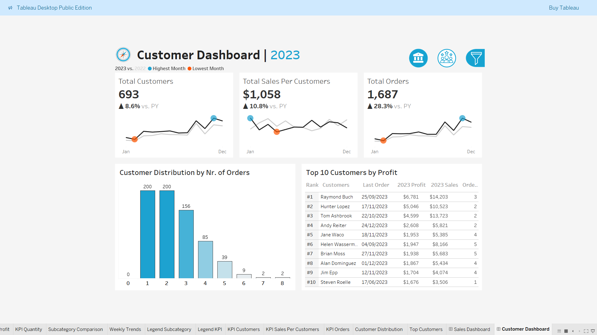
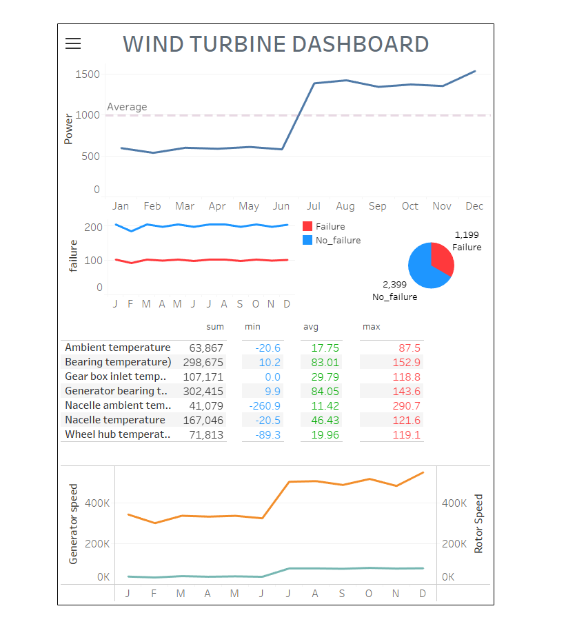

# Tableau BI Dashboards Portfolio

A collection of interactive business intelligence dashboards built in **Tableau**, designed for executive KPI tracking, customer retention analysis, and operational telemetry monitoring.

---

## 1. Executive Sales & Customer Analytics (2023)

A two-view commercial dashboard comparing **2023 performance against 2022 (PY)** with dynamic navigation, YoY variance indicators, and automated high/low month callouts.

### Sales Dashboard

* **Executive KPIs:** Total Sales **$733K** (+20.4% vs. PY), Total Profit **$93K** (+12.5% vs. PY), and Total Quantity **12K** (+26.8% vs. PY).
* **Subcategory Performance:** Side-by-side 2023 vs. 2022 sales bars paired with profit/loss indicators to flag margin leaks (e.g., Tables, Machines, Bookcases, Supplies).
* **Weekly Trends:** Step charts tracking weekly Sales (Avg. $14K) and Profit (Avg. $2K) above and below average benchmarks.

### Customer Dashboard

* **Customer KPIs:** **693** Total Customers (+8.6% vs. PY), **$1,058** Sales per Customer (+10.8% vs. PY), and **1,687** Total Orders (+28.3% vs. PY).
* **Order Frequency Distribution:** Histogram showing customer purchase frequency (peaking at 1–2 orders per customer).
* **Top 10 Customers by Profit:** Ranked leaderboard tracking last order date, 2023 profit, 2023 sales, and order count.

---

## 2. Wind Turbine Operational & Failure Dashboard

An industrial telemetry dashboard built to monitor power generation, equipment failure rates, and critical component temperatures across a 12-month cycle.

* **Power Output Monitoring:** Monthly power generation trend against an average reference benchmark (~1,000), highlighting a major output shift in H2 (Jul–Dec).
* **Failure Analysis:** Monthly `Failure` vs. `No_failure` trend lines paired with an overall split (**1,199 Failures** vs. **2,399 No_failure**).
* **Component Temperature Telemetry:** Summary matrix (`sum`, `min`, `avg`, `max`) across 7 critical sensors—Ambient, Bearing, Gearbox Inlet, Generator Bearing, Nacelle Ambient, Nacelle, and Wheel Hub temperatures.
* **Speed Correlation:** Dual-axis line chart comparing **Generator Speed** and **Rotor Speed** across months, paired with an interactive slide-out filter panel for Failure Status and Month.

---

## Tools & Skills Demonstrated
* **BI & Visualization:** Tableau Desktop Public Edition
* **Design & UX:** Executive KPI cards, YoY sparklines, dual-axis charts, step charts, custom navigation icons, and collapsible filter drawers
